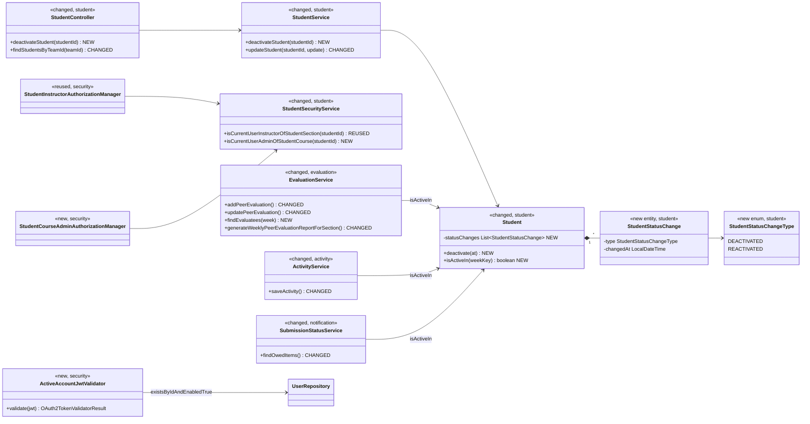
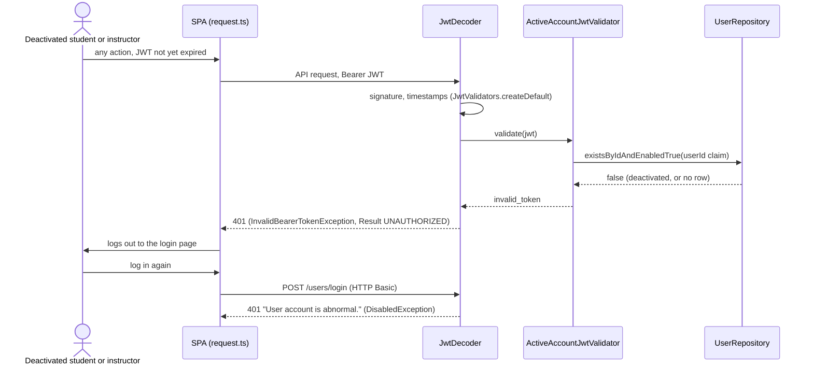
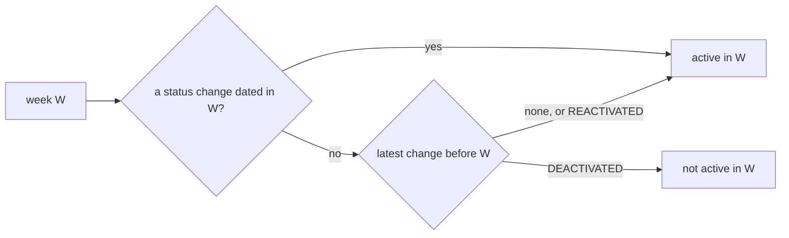
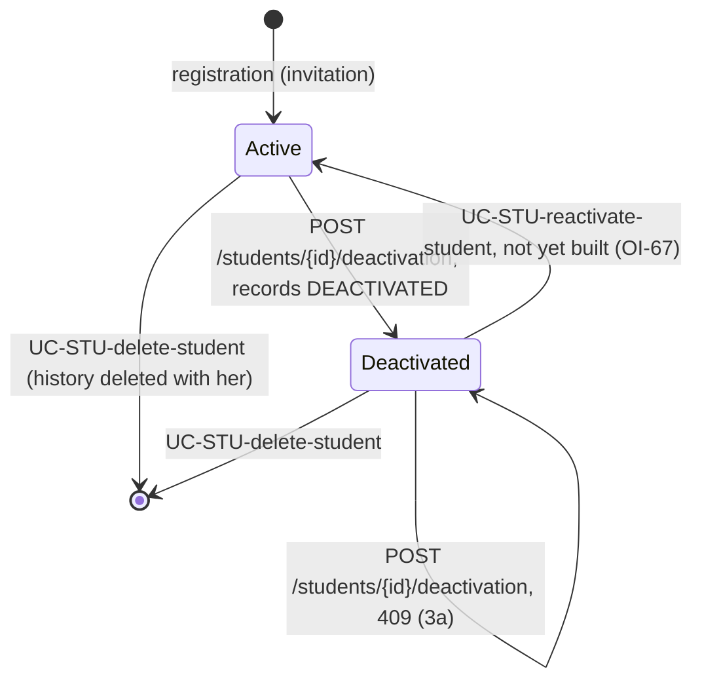
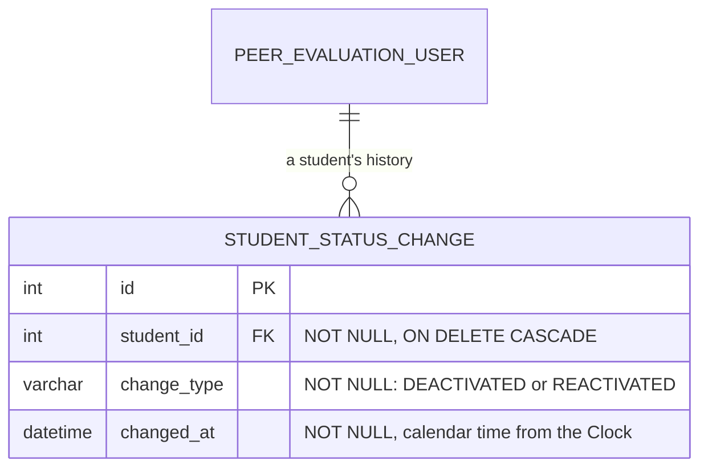

# Students (STU) Design

> Realizes: UC-STU-deactivate-student
> Depends on: FR-SEC-active-account, BR-student-lifecycle (who may deactivate her), BR-student-active-week (her history and the weeks she was active in), BR-submission-owed, BR-section-scoped-access, BR-team-scoped-access, BR-lock-expiry, CO-ferpa
> See: [use cases](../requirements/use-cases.md#student), [SRS security requirements](../requirements/software-requirements-specification.md#security-and-authorization-requirements), [architectural-design.md](architectural-design.md#shared-foundation-components) (shared foundation component view, Crosscutting Concepts › Security & Compliance)
> Designed against `main` at `59f0267` (2026-11-04).

## Overview

This area is the student's account lifecycle inside the foundation's `student` slice. UC-STU-deactivate-student replaces what the code did before, where deactivation was only a side effect of the generic `PUT /students/{studentId}` (an `enabled` switch in the edit-student form, no confirmation, no history, and a JWT that kept working for 2 hours), with four pieces:

- **A deactivation command.** A dedicated, confirmed endpoint.
- **A history.** Every deactivation is recorded with its date and kept on the `Student` aggregate, because BR-student-active-week decides from that history which weeks she was active in.
- **A per-request account check.** It lives in the JWT decoder and denies every deactivated account on its next request (FR-SEC-active-account).
- **Week-scoped consumers.** `evaluation`, `activity`, and `notification` ask the student whether she was active in a week, instead of reading her current status.

Reactivation (UC-STU-reactivate-student) is **not** designed here. Deactivation is one-way until that use case is built (OI-67): no code path writes a `REACTIVATED` change yet, so only test fixtures create one, and the rules for a student's own submissions in an inactive week (UC-EVA 1d, UC-WAR 3a) cannot be reached by a real student until then. They are built now because BR-student-active-week already requires them.

The per-request account check also changes another area: a deactivated instructor's open session (UC-INS-deactivate-instructor) is now refused on its next request too, as FR-SEC-active-account requires.

## Components & classes



- **`student/` (foundation)**
  - [`Student`](../../backend/src/main/java/team/projectpulse/student/Student.java) owns `statusChanges` (`@OneToMany(mappedBy = "student", cascade = ALL, orphanRemoval = true)`, ordered by `changedAt`).
  - `deactivate(LocalDateTime at)` throws `StudentAlreadyDeactivatedException` when she is not enabled. Otherwise it sets `enabled` false and appends a `DEACTIVATED` change.
  - `isActiveIn(String weekKey)` applies [the rule below](#active-in-a-week).
  - New `StudentStatusChange` entity and `StudentStatusChangeType` enum, in `student/`. The new `StudentAlreadyDeactivatedException` sits in `system/exception/` with every other exception `ExceptionHandlerAdvice` maps.
  - [`StudentService`](../../backend/src/main/java/team/projectpulse/student/StudentService.java):
    - New `deactivateStudent(studentId)` loads the student with a pessimistic write lock (`StudentRepository.findWithLockById`, `@Lock(PESSIMISTIC_WRITE)`), so two concurrent deactivations serialize and the second gets 3a. It takes the time from the injected `Clock` (`LocalDateTime.now(clock)`, calendar time).
    - `updateStudent` keeps copying only the named fields (username, names, email) onto the managed entity, as it does today, and no longer reads `update.isEnabled()` at all. It never assigns `statusChanges` or merges a converted `Student`: with `orphanRemoval`, a merge would delete her history.
  - [`StudentController`](../../backend/src/main/java/team/projectpulse/student/StudentController.java):
    - New `deactivateStudent`.
    - `findStudentsByTeamId` returns a `TeammateDto` (a `StudentDto` without `enabled`) to a caller without `ROLE_instructor`, and the unchanged `StudentDto` to an instructor or course admin. The test is `UserUtils.hasRole("ROLE_instructor")` on the token's literal authorities, which works because every course admin is provisioned with `instructor` in her roles (the invariant under Crosscutting Concepts › Authorization). A new `StudentToTeammateDtoConverter` builds the DTO.
  - [`StudentSecurityService`](../../backend/src/main/java/team/projectpulse/student/StudentSecurityService.java): new `isCurrentUserAdminOfStudentCourse(studentId)`. It returns `false` when the id names no student, and never throws.
- **`security/` (foundation)**
  - New `authorizationmanagers/StudentCourseAdminAuthorizationManager` reads `studentId` and delegates to `isCurrentUserAdminOfStudentCourse`.
  - New `ActiveAccountJwtValidator` implements `OAuth2TokenValidator<Jwt>`. It reads the `userId` claim, accepting an Integer, Long, or String the way `UserUtils.getUserId` does. It asks `UserRepository.existsByIdAndEnabledTrue` (one indexed read that loads none of the user's eager associations), and fails with `invalid_token` when the claim is missing or malformed, no row matches, or `enabled` is false. Signature verification runs before any validator, but `DelegatingOAuth2TokenValidator` runs every validator, so an expired signed token also costs the one read. That is harmless.
  - [`SecurityConfiguration`](../../backend/src/main/java/team/projectpulse/security/SecurityConfiguration.java):
    - Two new route rules, placed above the `denyAll()` catch-all.
    - `jwtDecoder()` sets `DelegatingOAuth2TokenValidator(JwtValidators.createDefault(), activeAccountJwtValidator)`, so the default timestamp checks still run.
  - [`ExceptionHandlerAdvice`](../../backend/src/main/java/team/projectpulse/system/exception/ExceptionHandlerAdvice.java) maps `StudentAlreadyDeactivatedException` to `409 CONFLICT`.
  - Unchanged: `JwtProvider`, because the check reads the account live and needs no claim, and `UserOwnershipAuthorizationManager` (see OI-66).
- **Feature slices** (each calls `Student.isActiveIn`; none computes the rule itself)
  - [`EvaluationService`](../../backend/src/main/java/team/projectpulse/evaluation/EvaluationService.java):
    - `addPeerEvaluation` and `updatePeerEvaluation` refuse an evaluator or evaluatee who was not active in that week.
    - New `findEvaluatees(week)` lists the caller's teammates who were active in that week.
    - `generateWeeklyPeerEvaluationReportForSection` skips students who were not active in that week, and sets `deactivated` on each `PeerEvaluationAverage` row from her current status. The report's "did not turn in" list is not computed here: the page takes it from `notification` `getSubmissionStatus`, as [design/not.md](not.md) already does, so a student deactivated after the week is listed in the report but not as owing.
  - [`ActivityService.saveActivity`](../../backend/src/main/java/team/projectpulse/activity/ActivityService.java) refuses a submitter who was not active in the activity's week. Edits and deletes need no gate: creation is the only way an activity gets a week (`updateActivity` never changes it), so every stored activity of hers is in a week she was active in.
  - [`SubmissionStatusService.findOwedItems`](../../backend/src/main/java/team/projectpulse/notification/SubmissionStatusService.java) changes in two ways:
    - **Who owes:** a student on a team, with `enabled`, who `isActiveIn(week)`.
    - **Whom she owes evaluations of:** every member of her team who `isActiveIn(week)`, whatever that member's current status. This list is no longer the eligible list.
- **Repository (changed):** `StudentRepository` gains a section query that fetch-joins `statusChanges` (an `@EntityGraph` on `findBySectionSectionId`), so the section report and the owed computation read the course section's history in one query.
- **Frontend**
  - `src/apis/student/`: new `deactivateStudent(id)`, and a `Teammate` type for the student-caller response.
  - `src/apis/evaluation/`: new `findEvaluatees(week)`.
  - [`pages/students/EditStudentForm.vue`](../../frontend/src/pages/students/EditStudentForm.vue):
    - The Status switch is removed.
    - In its place: an Active or Deactivated tag, and a **Deactivate** button shown only while she is active.
    - The form is reached from `Students.vue`, whose route requires the `instructor` permission, so assigned instructors and course admins both get it.
    - The button opens `ElMessageBox.confirm` with the consequences from the use case's Associated Information: she can no longer log in or submit, her work is kept, and she stays on her team. The clause that she "can be reactivated in the future" is left out until UC-STU-reactivate-student ships (OI-67), because the app would be promising a control it doesn't have.
    - Errors go through the shared Axios handler: a `409` raises its one toast ("This student is already deactivated."), after which the form reloads the student, so the tag shows Deactivated and the button disappears. A `403` sends the user to the forbidden page (3b).
    - The form no longer sends `enabled`.
  - [`pages/students/Students.vue`](../../frontend/src/pages/students/Students.vue): the status tag reads Active or Deactivated.
  - Instructor-facing member lists show a Deactivated tag:
    - [`pages/teams/Teams.vue`](../../frontend/src/pages/teams/Teams.vue), from `StudentDto.enabled`.
    - [`pages/evaluations/admin/SectionsEvaluations.vue`](../../frontend/src/pages/evaluations/admin/SectionsEvaluations.vue), from the report row's `deactivated`.
    - [`pages/activities/admin/SectionsActivities.vue`](../../frontend/src/pages/activities/admin/SectionsActivities.vue), from the course section's student roster (`searchStudents`, instructor-only, page size 100 as `Teams.vue` uses), matched by `studentId`.
  - [`pages/evaluations/SubmitTeamsEvaluations.vue`](../../frontend/src/pages/evaluations/SubmitTeamsEvaluations.vue) builds its rows from `findEvaluatees(week)` instead of `findStudentsByTeamId`, and shows no status.

## Sequence

### UC-STU-deactivate-student: deactivate a student

```mermaid
sequenceDiagram
    actor A as Instructor or course admin
    participant V as EditStudentForm.vue
    participant SEC as SecurityConfiguration
    participant C as StudentController
    participant S as StudentService
    participant E as Student
    participant DB as MySQL
    A->>V: open the student (steps 1-2, via UC-STU-view-student)
    A->>V: Deactivate (step 3; shown only while she is active)
    V->>A: confirm dialog with the consequences (step 4)
    alt Cancel (4a)
        A->>V: Cancel
        Note over V: no request; nothing changes
    else Confirm (step 5)
        A->>V: Confirm
        V->>SEC: POST /students/{studentId}/deactivation
        SEC->>SEC: anyOf(StudentInstructorAM, StudentCourseAdminAM)
        Note over SEC: neither: 403 (3b)
        SEC->>C: deactivateStudent(studentId)
        C->>S: deactivateStudent(studentId)
        S->>E: deactivate(LocalDateTime.now(clock))
        Note over E: already deactivated: StudentAlreadyDeactivatedException, 409 (3a)
        E->>E: enabled = false; append DEACTIVATED change
        S->>DB: save (history cascades)
        C-->>V: 200, StudentDto (enabled false)
        V->>A: "Student deactivated" (step 6); tag shows Deactivated
    end
```

### FR-SEC-active-account: an open session after deactivation



### Active in a week

BR-student-active-week, as `Student.isActiveIn(weekKey)` applies it:



- **Why a change inside W makes her active:** she was active for part of W either way. A deactivation in W means she was active before it; a reactivation in W means she is active after it. That is how both ends of an inactive period count as active weeks.
- **Mapping a change to its week:** `WeekKeys.of(changedAt.toLocalDate())`. `changedAt` is calendar time in the clock's zone (`app.timezone`, America/Chicago).
- **Comparing weeks:** by `WeekKeys.monday(weekKey)`, never by string order.

### The account lifecycle



## API contract

| Endpoint or job | Caller (who may) | Request | Success | Errors, by extension |
|---|---|---|---|---|
| `POST /api/v1/students/{studentId}/deactivation` (new) | An instructor assigned to the student's course section, or the course admin of the course that owns it (BR-student-lifecycle): `AuthorizationManagers.anyOf(studentInstructorAuthorizationManager, studentCourseAdminAuthorizationManager)` | No body | `200`, `StudentDto` with `enabled: false` | **3a:** already deactivated → `409` `CONFLICT`, "This student is already deactivated.", nothing changes. **3b:** a student (herself included), an instructor not assigned to her course section, another course's admin, or an id that names no student → `403` (route rule; the managers fail closed) |
| `GET /api/v1/students/teams/{teamId}` (changed) | Unchanged (`teamMembershipAuthorizationManager`) | Unchanged | `200`. An instructor or course admin gets `StudentDto` with `enabled`. A student gets `TeammateDto`, the same fields **without** `enabled` (CO-ferpa) | Unchanged |
| `GET /api/v1/evaluations/weeks/{week}/evaluatees` (new) | `.authenticated()`. The service derives the team from the caller through `UserUtils` (point 2), so nothing in the URL names the team | `week`: an ISO key, checked by `WeekKeys.requireValid` | `200`: the caller's teammates who were active in that week, herself included, as `id`, `firstName`, `lastName`. No status field | A caller who is not a student → `400`. Not on a team (UC-EVA 1c) → `400`, the existing message. Caller not active in that week (UC-EVA 1d) → `400`, "You may submit a peer evaluation only for a week you were active in.". Malformed week → `400` `INVALID_ARGUMENT` |
| `POST /api/v1/evaluations`, `PUT /api/v1/evaluations/{evaluationId}` (changed) | Unchanged | Unchanged | Unchanged | **UC-EVA 4b:** evaluatee not active in that week → `400` `INVALID_ARGUMENT`, "<first name> <last name> is not evaluated for that week." (no reason given, CO-ferpa). **UC-EVA 1d:** evaluator not active in that week → `400`, as above |
| `POST /api/v1/activities` (changed) | Unchanged | Unchanged | Unchanged | **UC-WAR 3a:** submitter not active in the activity's week → `400` `INVALID_ARGUMENT`, "You may submit a weekly activity report only for a week you were active in." |
| `PUT /api/v1/students/{studentId}` (changed) | Unchanged | `enabled` is ignored, in both directions | Unchanged | Unchanged |
| `GET /api/v1/evaluations/sections/{sectionId}/week/{week}` (changed) | Unchanged | Unchanged | Omits students who were not active in that week. Each row carries `deactivated` (current status) | Unchanged |
| `GET /sections/{sectionId}/submission-status`, `POST /sections/{sectionId}/reminders`, `WeeklyReminderScheduler` (changed) | Unchanged | Unchanged | Owing follows the amended BR-submission-owed. See [design/not.md](not.md#key-decisions) | Unchanged |
| Every bearer-authenticated route (changed) | Any token holder | — | Unchanged for an active account | The account is deactivated or no longer exists, student or instructor → `401` `UNAUTHORIZED` (FR-SEC-active-account) |

## Key decisions

**A dedicated deactivation command.** `POST /students/{studentId}/deactivation` is the only way to deactivate a student. Rejected: keeping the generic `PUT`. A student can call it on herself, it skips the confirmation, it deactivated anyone whose request left `enabled` out (the primitive defaults to false), and it recorded nothing. The `PUT` now ignores `enabled` entirely. That makes deactivation one-way until UC-STU-reactivate-student is built (OI-67). Rejected: letting the `PUT` still re-enable, because it would reactivate her without recording a reactivation, and every later week would wrongly read as inactive.

**History lives on the `Student` aggregate.** `StudentStatusChange` is a child collection of `Student`, so it cascades on save and is removed with her by UC-STU-delete-student's physical delete. Rejected: a standalone audit table keyed by user id, which needs its own clean-up on deletion and leaves the active-week rule outside the entity whose invariant it is. The `enabled` flag stays as the authentication flag. Invariant: `enabled` equals the latest change, or `true` when she has none. Rejected: deriving `enabled` from the history on every login and request, which adds a query to the hottest path to save one column.

**One implementation of "active in a week".** `Student.isActiveIn` is the only place the rule is computed, and `evaluation`, `activity`, and `notification` call it. Rejected: each slice working it out, which is how the "has not submitted" definitions drifted before ([design/not.md](not.md#key-decisions)). The feature slices already depend on `student`, so the call adds no dependency (`MNT-feature-locality`).

**Owing needs both today's status and the week's.** A student owes only if she is enabled now *and* was active in that week. Her teammates owe evaluations of everyone who was active in that week, whatever their status now. So a student deactivated in week W+1 is still owed an evaluation for W, and is not herself reminded about W (BR-submission-owed, as amended).

**The account check runs on every request, for every user.** `ActiveAccountJwtValidator` runs after the default validators, so a deactivated or deleted account's token is refused on its next request. It costs one primary-key read per authenticated request, which is negligible at course scale. Rejected:

- Relying on the 2-hour expiry, which breaks FR-SEC-active-account.
- A token-version claim in `JwtProvider`: it needs the same read, and its only extra effect (killing tokens issued before a reactivation) is required by nothing.
- Placing the check in `JwtAuthenticationConverter`: "is this token still good" is validation, and the validator already produces the standard `invalid_token` `401`.
- A student-only check: FR-SEC-active-account names instructors too, so a deactivated instructor's token is now refused as well.

**Students never receive another student's status (CO-ferpa).** No response a student can call carries a teammate's status:

- The evaluatee list returns names only, and the server decides who is listed.
- `GET /students/teams/{teamId}` returns `TeammateDto`, which has no `enabled`, to a student caller.
- The "not evaluated" refusal names the teammate but never says why.
- The `SectionsActivities.vue` label comes from the instructor-only roster, not `ActivityDto`, which students also receive.

These are every response a student can call that names another student. The others carry no status: `ActivityDto`, `PeerEvaluationDto`, and `TeamDto` (which embeds no students). The login `userInfo` and `GET /students/{studentId}` give a student only her own record.

Rejected:

- Filtering the existing team list in the browser: the browser would need every teammate's status, and the rule would be implemented twice.
- Nulling `enabled` in `StudentDto` for students: the field is a primitive, and a nullable one would still be serialized.
- Closing `GET /students/teams/{teamId}` to students: it would change a route students already use (`StudentIntegrationTest.testStudentJohnFindStudentsInOwnTeam`).

**Authorization composes managers.** The new route uses `anyOf(StudentInstructorAuthorizationManager, StudentCourseAdminAuthorizationManager)`, following the precedent in [design/not.md](not.md#key-decisions). Point 2 needs no scoped query: the object acted on is the student the route rule checked, and no id comes from a body. Rejected: `UserOwnershipAuthorizationManager`, which admits the student herself and refuses an owning course admin who is not assigned to the course section. Accepted gap: such a course admin can deactivate through the endpoint but cannot reach the student's page in the app (OI-66).

**"Already deactivated" is a conflict, not a success.** `409` (`StatusCode.CONFLICT`, which already exists) with a message. Rejected: an idempotent `200`, because step 6 would then announce a deactivation that did not happen. Two concurrent confirms serialize on the pessimistic lock, so exactly one succeeds. Rejected: `@Version` on `Student`, which would turn every concurrent edit of any student field into an optimistic-lock failure the existing forms don't handle. An id that names no student gets `403`, not `404`: the route rule refuses before the service runs (Crosscutting Concepts › Authorization, "Guards fail closed").

**No email to her, and no explicit release of her edit locks.** The use case calls for no notification (UC-STU-reactivate-student does). Any lock she holds lapses under BR-lock-expiry. Rejected: a release hook in `deactivateStudent`, which would couple `student` to `ram`.

**The login refusal stays generic.** A deactivated account's login still gets "User account is abnormal.". Rejected: "your account is deactivated", because Spring's pre-authentication checks read `isEnabled` before the password is verified, so a specific message would tell anyone who knows an email address that the account is deactivated.

## Data model

The delta against the SRS's [Business Domain Model](../requirements/software-requirements-specification.md#business-domain-model) is one child table of `Student`:



- **Migration `V7__student_status_history.sql`.** It creates the table, with an index on `(student_id, changed_at)`. It also backfills one `DEACTIVATED` row at `NOW()` for every `peer_evaluation_user` row with `dtype = 'Student'` and `enabled = 0`, so a student disabled before history existed counts as deactivated from the moment the migration runs and active in every earlier week.
- **Accepted imprecision.** `NOW()` is the database server's time (UTC on Azure), not `app.timezone`, so a migration run near midnight can date the backfill in a neighbouring week. That is harmless for accounts already disabled.
- **`dev`.** `ddl-auto` builds the table, and `DataInitializer` has no disabled students, so it seeds no history.

## Reuse & cross-cutting

- **Authorization:** the existing `StudentInstructorAuthorizationManager`, composed with the new course-admin manager through `AuthorizationManagers.anyOf`. The deny-by-default catch-all is untouched.
- **Authentication:** the existing `NimbusJwtDecoder` and `JwtValidators.createDefault()`, with one more validator. The `401` is the existing `InvalidBearerTokenException` mapping in `ExceptionHandlerAdvice`, and the SPA's existing `401` handler in `utils/request.ts` logs the user out.
- **Time:** `WeekKeys` (`of`, `monday`, `requireValid`) and the injected `Clock`. The dev clock is fixed at Sunday 2023-08-20 (week `2023-W33`), so a deactivation in dev is dated in W33, and the previous week (W32) stays an active week for her.
- **Error envelope:** `PeerEvaluationIllegalArgumentException` and `ActivityIllegalArgumentException` (both `400`); the new `StudentAlreadyDeactivatedException` (`409`).
- **Locking:** BR-lock-expiry, unchanged.

## Tests

| Use case, flow | Level | Asserts |
|---|---|---|
| UC-STU-deactivate-student, main, assigned instructor | integration (`StudentIntegrationTest`) | b.gates deactivates John: `200`, `enabled` false. `Student` has exactly one `DEACTIVATED` change dated by the dev clock. His course section, team, activities, and peer evaluations are unchanged |
| Main, owning course admin not assigned to the course section | integration | Unassign b.wei from section 2, then deactivate John: `200` |
| 3a, already deactivated | unit (`StudentTest`, `StudentServiceTest`) and integration | `deactivate` on a deactivated student throws, and the history keeps one change. The second `POST` returns `409` with the message |
| 3b, permission denied | integration | `403` for each of: John on himself, John on Eric, an instructor not assigned to her course section, Tim Cook (admin of another course), and an id that names no student |
| 4a and steps 3 to 6 in the UI | Cypress, API stubbed | The Deactivate button shows only for an active student. The dialog shows the consequence text. Cancel sends no request. Confirm sends exactly one `POST`, shows success, and flips the tag. A `409` raises one toast with its message, and the form then shows Deactivated |
| FR-SEC-active-account, an open session | integration | A token John obtained before he was deactivated gets `401` on its next request. A new login gets `401`. A deactivated instructor's existing token gets `401` |
| `ActiveAccountJwtValidator` | unit | Enabled user → valid. Disabled user, no row, or no `userId` claim → `invalid_token` |
| BR-student-active-week, `isActiveIn` | unit (`StudentTest`) | No history → active. Deactivated in W → active in W, not in W+1. Reactivated in R → active in R, not in R-1. Deactivated and reactivated in one week → active in it. Deactivated again after a reactivation → not active in the weeks after |
| Boundary week, end to end | integration | Deactivate John in dev (W33). For W32 his teammates still owe him an evaluation (`SubmissionStatusServiceIntegrationTest`), may submit one, and he is listed in the evaluatee list and the section report. He himself is not listed as owing W32 |
| Inactive week, end to end | integration (fixture: a `DEACTIVATED` change at 2023-07-30 (W30) and a `REACTIVATED` change at 2023-08-14 (W33), with John left enabled, so W31 and W32 are inactive and he can still authenticate) | For W32: an evaluation of John → `400` naming him. John's own evaluation and activity for W32 → `400`. He is absent from his teammates' evaluatee list and from the section report. His teammates do not owe him an evaluation |
| Generic `PUT` | integration | `enabled: false` from an instructor leaves the student active, with no history change. `enabled: true` on a deactivated student leaves her deactivated. A `PUT` on a student with history keeps every history row |
| 3a under concurrency | integration | Two deactivations of John in separate transactions: one `200`, one `409`, one history row |
| Calendar time round trip | integration | A deactivation at the dev clock (Sunday 2023-08-20 23:30, America/Chicago) reads back as 2023-08-20T23:30, so its week is still W33. A driver that shifted it to UTC would put it in W34 |
| CO-ferpa, the team members list | integration | `GET /students/teams/{teamId}` by a student has no `enabled` field in any element. By an instructor, `enabled` is present |
| CO-ferpa, the evaluation form | integration and Cypress, API stubbed | The evaluatees response has only `id`, `firstName`, `lastName`. The form lists exactly that response and shows no status |
| Decision 1, the Deactivated label | Cypress, API stubbed; integration for the report | A deactivated student shows a Deactivated tag on `Teams.vue`, `SectionsEvaluations.vue`, and `SectionsActivities.vue`, in the instructor and course admin views. No student view shows it. Integration: the section report row of a student deactivated in W33, for W32, carries `deactivated: true` |
| Migration backfill | manual check against a Flyway-migrated database (the integration suite runs on the `dev` schema) | A student with `enabled = 0` gets exactly one `DEACTIVATED` row, and an enabled student gets none |

## Open questions / risks

- **One read per authenticated request.** About 80 students make a negligible load at course scale. Revisit together with TD-jwt-revocation if the app goes multi-instance or gains a cache.
- **History reads in reports.** The section report and the owed computation must use the fetch-join query. Without it, a section of about 80 students issues about 80 extra selects per call.
- **The migration is checked by hand only.** No automated test runs Flyway, so a typo in `V7` would surface first in staging. The PR's *Not verified* line names it.
